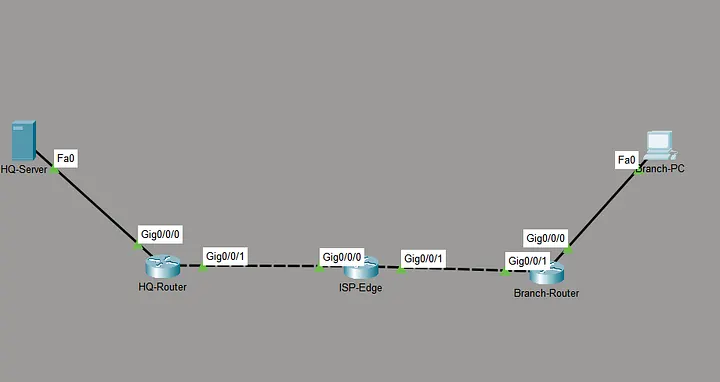
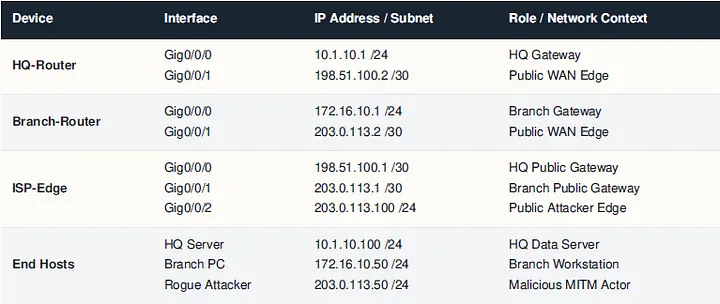

# SOP: Site-to-Site IPsec VPN (Cisco Packet Tracer)

| Field | Value |
|-------|-------|
| Document type | Standard Operating Procedure |
| Version | 1.1 |
| Date | 2026-10-18 |
| Scenario | Two private LANs connected across a public ISP with eavesdropper on the WAN |
| Equipment | Cisco Packet Tracer 8.2+, ISR4331 routers |
| Est. time | 60 to 90 minutes |
| Audience | Experienced engineer refreshing CCNA / ENSA material |

> **About the CLI blocks below:** every line shows the live Cisco IOS prompt (`Router>`, `Router#`, `HQ-Router(config)#`, `HQ-Router(config-if)#`, etc.) so you can see which mode you're in. When pasting into a real terminal, strip the prompt prefix from each line.

## 1. Purpose

Establish an IKEv1 IPsec site-to-site VPN between HQ and Branch across an untrusted ISP. Demonstrate that a rogue host attached to the public WAN cannot read tunneled traffic. Produce a working, repeatable config that can be adapted to real ISR hardware.

## 2. Scope

**In scope:**
- IKE Phase 1 (ISAKMP) policy and pre-shared key authentication
- IKE Phase 2 (IPsec ESP) transform set, crypto map, interesting-traffic ACL
- End-to-end verification with `show crypto` commands
- Eavesdropping demonstration from a WAN-attached rogue PC

**Out of scope:**
- IKEv2 / FlexVPN
- Certificate-based peer authentication
- Dynamic VTI, GRE over IPsec, DMVPN
- NAT traversal (NAT-T)
- Routing protocol inside the tunnel

## 3. Prerequisites

**Knowledge:**
- Cisco IOS CLI, config modes, saving and reverting
- Extended ACL syntax (wildcard masks)
- Difference between control plane (ISAKMP) and data plane (ESP)
- Basic symmetric vs asymmetric crypto, Diffie-Hellman purpose

**Lab:**
- Packet Tracer 8.2 or later
- Four Cisco routers (HQ, ISP-Edge, Branch, plus the attacker runs on a PC not a router)
- One server on HQ LAN, one PC on Branch LAN, one PC on the ISP public segment acting as attacker

## 4. Topology and addressing





Same table in plain text for quick copy-paste reference:

| Device | Interface | IP / Mask | Role |
|--------|-----------|-----------|------|
| HQ-Router | Gig0/0/0 | 10.1.10.1 /24 | HQ gateway |
| HQ-Router | Gig0/0/1 | 198.51.100.2 /30 | Public WAN edge |
| ISP-Edge | Gig0/0/0 | 198.51.100.1 /30 | HQ public gateway |
| ISP-Edge | Gig0/0/1 | 203.0.113.1 /30 | Branch public gateway |
| ISP-Edge | Gig0/0/2 | 203.0.113.100 /24 | Attacker edge |
| Branch-Router | Gig0/0/0 | 172.16.10.1 /24 | Branch gateway |
| Branch-Router | Gig0/0/1 | 203.0.113.2 /30 | Public WAN edge |
| HQ-Server | NIC | 10.1.10.100 /24 | HQ data server |
| Branch-PC | NIC | 172.16.10.50 /24 | Branch workstation |
| Rogue Attacker | NIC | 203.0.113.50 /24 | MITM demo host |

> **Note:** `203.0.113.0/30` (Branch WAN) overlaps the `203.0.113.0/24` attacker segment. Longest-prefix match on ISP-Edge keeps routing correct. If your version of Packet Tracer complains, change the attacker segment to `203.0.113.128/25`.

## 5. Procedure

Perform the steps in order. Save after each major step with `copy running-config startup-config`.

### Step 1: Base interface configuration

**HQ-Router:**
```
Router> enable
Router# configure terminal
Router(config)# hostname HQ-Router
HQ-Router(config)# interface GigabitEthernet0/0/0
HQ-Router(config-if)# description LAN to HQ-Server
HQ-Router(config-if)# ip address 10.1.10.1 255.255.255.0
HQ-Router(config-if)# no shutdown
HQ-Router(config-if)# exit
HQ-Router(config)# interface GigabitEthernet0/0/1
HQ-Router(config-if)# description WAN to ISP-Edge
HQ-Router(config-if)# ip address 198.51.100.2 255.255.255.252
HQ-Router(config-if)# no shutdown
HQ-Router(config-if)# exit
HQ-Router(config)# ip route 0.0.0.0 0.0.0.0 198.51.100.1
HQ-Router(config)# end
HQ-Router# copy running-config startup-config
```

**Branch-Router:**
```
Router> enable
Router# configure terminal
Router(config)# hostname Branch-Router
Branch-Router(config)# interface GigabitEthernet0/0/0
Branch-Router(config-if)# description LAN to Branch-PC
Branch-Router(config-if)# ip address 172.16.10.1 255.255.255.0
Branch-Router(config-if)# no shutdown
Branch-Router(config-if)# exit
Branch-Router(config)# interface GigabitEthernet0/0/1
Branch-Router(config-if)# description WAN to ISP-Edge
Branch-Router(config-if)# ip address 203.0.113.2 255.255.255.252
Branch-Router(config-if)# no shutdown
Branch-Router(config-if)# exit
Branch-Router(config)# ip route 0.0.0.0 0.0.0.0 203.0.113.1
Branch-Router(config)# end
Branch-Router# copy running-config startup-config
```

**ISP-Edge** (missing from most tutorials; the WAN link does not work without it):
```
Router> enable
Router# configure terminal
Router(config)# hostname ISP-Edge
ISP-Edge(config)# interface GigabitEthernet0/0/0
ISP-Edge(config-if)# description Link to HQ-Router
ISP-Edge(config-if)# ip address 198.51.100.1 255.255.255.252
ISP-Edge(config-if)# no shutdown
ISP-Edge(config-if)# exit
ISP-Edge(config)# interface GigabitEthernet0/0/1
ISP-Edge(config-if)# description Link to Branch-Router
ISP-Edge(config-if)# ip address 203.0.113.1 255.255.255.252
ISP-Edge(config-if)# no shutdown
ISP-Edge(config-if)# exit
ISP-Edge(config)# interface GigabitEthernet0/0/2
ISP-Edge(config-if)# description Public segment with attacker host
ISP-Edge(config-if)# ip address 203.0.113.100 255.255.255.0
ISP-Edge(config-if)# no shutdown
ISP-Edge(config-if)# exit
ISP-Edge(config)# end
ISP-Edge# copy running-config startup-config
```

**Verify Layer 3 before continuing:**
```
HQ-Router# ping 198.51.100.1
Branch-Router# ping 203.0.113.1
HQ-Router# ping 203.0.113.2
```
All three must succeed. End hosts cannot ping each other yet (private subnets have no public route on ISP-Edge). This is expected and will be solved by the IPsec tunnel in later steps.

### Step 2: IKE Phase 1 (ISAKMP control-plane tunnel)

**HQ-Router:**
```
HQ-Router# configure terminal
HQ-Router(config)# crypto isakmp policy 10
HQ-Router(config-isakmp)# encryption aes 256
HQ-Router(config-isakmp)# hash sha
HQ-Router(config-isakmp)# authentication pre-share
HQ-Router(config-isakmp)# group 5
HQ-Router(config-isakmp)# lifetime 86400
HQ-Router(config-isakmp)# exit
HQ-Router(config)# crypto isakmp key SecretKey123 address 203.0.113.2
HQ-Router(config)# end
```

**Branch-Router** (policy numbers and parameters MUST match or Phase 1 fails):
```
Branch-Router# configure terminal
Branch-Router(config)# crypto isakmp policy 10
Branch-Router(config-isakmp)# encryption aes 256
Branch-Router(config-isakmp)# hash sha
Branch-Router(config-isakmp)# authentication pre-share
Branch-Router(config-isakmp)# group 5
Branch-Router(config-isakmp)# lifetime 86400
Branch-Router(config-isakmp)# exit
Branch-Router(config)# crypto isakmp key SecretKey123 address 198.51.100.2
Branch-Router(config)# end
```

**Parameter cheat sheet:**

| Setting | Value here | Why |
|---------|-----------|-----|
| encryption | AES-256 | Strong symmetric cipher for the Phase 1 tunnel |
| hash | SHA-1 | Lab convenience. **Production should use SHA-256 or higher.** |
| authentication | pre-share | Simplest for lab. Production should use certificates. |
| DH group | 5 (1536 bit) | **Legacy. Production should use group 14 (2048) or group 19/21 (ECC).** |
| lifetime | 86400 s (24 h) | Standard default |
| PSK | SecretKey123 | **Weak. Lab only. Rotate and store securely in production.** |

### Step 3: Interesting-traffic ACL

Define which traffic triggers the tunnel. The two ACLs must mirror each other.

**HQ-Router:**
```
HQ-Router# configure terminal
HQ-Router(config)# access-list 100 permit ip 10.1.10.0 0.0.0.255 172.16.10.0 0.0.0.255
HQ-Router(config)# end
```

**Branch-Router:**
```
Branch-Router# configure terminal
Branch-Router(config)# access-list 100 permit ip 172.16.10.0 0.0.0.255 10.1.10.0 0.0.0.255
Branch-Router(config)# end
```

### Step 4: IKE Phase 2 (IPsec data-plane tunnel)

Both routers must use the SAME transform-set algorithms. Pick one combo and stick with it on both ends.

**HQ-Router:**
```
HQ-Router# configure terminal
HQ-Router(config)# crypto ipsec transform-set TS-SET esp-aes 256 esp-sha-hmac
HQ-Router(cfg-crypto-trans)# exit
HQ-Router(config)# crypto map VPN-MAP 10 ipsec-isakmp
HQ-Router(config-crypto-map)# set peer 203.0.113.2
HQ-Router(config-crypto-map)# set transform-set TS-SET
HQ-Router(config-crypto-map)# match address 100
HQ-Router(config-crypto-map)# exit
HQ-Router(config)# interface GigabitEthernet0/0/1
HQ-Router(config-if)# crypto map VPN-MAP
HQ-Router(config-if)# exit
HQ-Router(config)# end
```

**Branch-Router:**
```
Branch-Router# configure terminal
Branch-Router(config)# crypto ipsec transform-set TS-SET esp-aes 256 esp-sha-hmac
Branch-Router(cfg-crypto-trans)# exit
Branch-Router(config)# crypto map VPN-MAP 10 ipsec-isakmp
Branch-Router(config-crypto-map)# set peer 198.51.100.2
Branch-Router(config-crypto-map)# set transform-set TS-SET
Branch-Router(config-crypto-map)# match address 100
Branch-Router(config-crypto-map)# exit
Branch-Router(config)# interface GigabitEthernet0/0/1
Branch-Router(config-if)# crypto map VPN-MAP
Branch-Router(config-if)# exit
Branch-Router(config)# end
```

> **Note:** expect to see the console log `%CRYPTO-6-ISAKMP_ON_OFF: ISAKMP is ON` right after `crypto map` is applied. If you do not, re-check that the map name is spelled identically on both routers.

### Step 5: Trigger the tunnel and verify

The tunnel is dormant until interesting traffic arrives. From Branch-PC command prompt:
```
C:\> ping 10.1.10.100
```
First one or two ICMP replies will time out (SAs are being negotiated). Subsequent pings should return.

**Validate Phase 1 on either router:**
```
HQ-Router# show crypto isakmp sa
```
Expected: a line with `QM_IDLE` state and the two peer IPs. `QM_IDLE` means Phase 1 is up and resting.

**Validate Phase 2:**
```
HQ-Router# show crypto ipsec sa
```
Expected (fragments shown):
```
    #pkts encaps: N, #pkts encrypt: N, #pkts digest: N
    #pkts decaps: N, #pkts decrypt: N, #pkts verify: N
```
Both counters increase as traffic flows. `encaps`/`encrypt` matching on one side and `decaps`/`decrypt` matching on the other confirms end-to-end ESP.

## 6. Validation checklist

- [ ] All three routers show interfaces up/up with the correct IPs
- [ ] Routers can ping each other across the public WAN
- [ ] Private LAN hosts cannot reach each other BEFORE Step 4
- [ ] After Step 4, Branch-PC can ping HQ-Server (first attempt may fail)
- [ ] `show crypto isakmp sa` reports `QM_IDLE`
- [ ] `show crypto ipsec sa` encrypt and decrypt counters are increasing
- [ ] Configs saved on all three routers with `copy running-config startup-config`

## 7. Attack demonstration (rogue host on WAN)

Goal: prove that an attacker on the public segment cannot read tunneled traffic even though they see the packets.

1. Place a PC on ISP-Edge Gig0/0/2 with IP `203.0.113.50 /24`, gateway `203.0.113.100`.
2. Switch Packet Tracer to Simulation Mode. Filter for ICMP, IP, and ESP.
3. From Branch-PC, ping HQ-Server.
4. Click a captured packet on the ISP-Edge-to-HQ link. Expand the IP header.
5. Expected observations:
   - Outer IP header: source `203.0.113.2`, destination `198.51.100.2` (the ROUTER public IPs, not the LAN hosts).
   - Protocol: 50 (ESP). Not ICMP.
   - Payload: opaque ESP data. The ICMP echo, LAN source `172.16.10.50`, and LAN destination `10.1.10.100` are NOT visible.
6. Contrast: remove the crypto map from one interface, re-run the ping, inspect again. The LAN source/destination and the ICMP contents are now visible in cleartext.
7. Re-apply the crypto map before continuing.

**Takeaway:** ESP hides both the payload AND the real LAN addresses behind the two public router IPs. The attacker learns only that encrypted traffic flows between the two WAN endpoints.

## 8. Hardening checklist (production delta)

| Weakness in this lab | Production replacement |
|----------------------|------------------------|
| SHA-1 hash | SHA-256 or SHA-384 |
| DH group 5 (1536-bit) | DH group 14 (2048-bit), group 19 (ECC P-256), or group 21 (ECC P-521) |
| IKEv1 | IKEv2 |
| Pre-shared key | Certificate-based peer authentication |
| Static weak PSK `SecretKey123` | Rotated high-entropy PSK stored in a secret manager; or move to certs |
| No PFS | `set pfs group14` under the crypto map |
| No dead peer detection | `crypto isakmp keepalive 10 periodic` |
| CLI accessible from WAN | Restrict VTY to management SVI with ACL + SSH only |
| No logging | `logging host`, `logging trap informational` to a central syslog |

## 9. Common failure modes

| Symptom | Likely cause | Fix |
|---------|--------------|-----|
| `show crypto isakmp sa` shows `MM_NO_STATE` or nothing | Phase 1 policy mismatch (encryption, hash, DH group) | Verify both routers use identical `crypto isakmp policy 10` parameters |
| `show crypto isakmp sa` cycles through states | PSK mismatch or wrong peer IP | Check `crypto isakmp key ... address ...` on both sides |
| Phase 1 up, Phase 2 never forms | Transform-set algorithms differ, or ACLs are not mirror images | Match transform-set exactly; invert source/destination in ACL 100 |
| Tunnel up but no traffic encrypted | Traffic does not match ACL 100 | Confirm wildcard masks and subnet alignment |
| Everything correct but no reachability | Crypto map not applied to WAN interface | `show run interface Gig0/0/1` and confirm `crypto map VPN-MAP` line |
| Routers reach each other but LAN hosts cannot | Default route missing OR tunnel is not up | Check `show ip route` and `show crypto ipsec sa` |

## 10. Rollback

To cleanly remove the VPN without touching base routing. Apply on both HQ-Router and Branch-Router (adjust the peer IP for each). Base interfaces and default routes remain intact.

```
HQ-Router# configure terminal
HQ-Router(config)# interface GigabitEthernet0/0/1
HQ-Router(config-if)# no crypto map VPN-MAP
HQ-Router(config-if)# exit
HQ-Router(config)# no crypto map VPN-MAP 10
HQ-Router(config)# no crypto ipsec transform-set TS-SET
HQ-Router(config)# no access-list 100
HQ-Router(config)# no crypto isakmp key SecretKey123 address 203.0.113.2
HQ-Router(config)# no crypto isakmp policy 10
HQ-Router(config)# end
HQ-Router# copy running-config startup-config
```

## 11. Sources

- Cisco IOS Security Command Reference (chapters: `crypto isakmp policy`, `crypto ipsec transform-set`, `crypto map`)
- Cisco CCNA 200-301 Official Cert Guide, Vol 2 (Odom): VPN concepts chapter
- RFC 2409 (IKEv1), RFC 4301 (IPsec architecture), RFC 4303 (ESP)
- Public lab writeups for the same ISR4331 Packet Tracer scenario; this SOP uses the same Cisco IOS CLI syntax (non-copyrightable) with independent prose, a corrected transform-set, and the ISP-Edge base config that most writeups omit.

---
End of SOP.
